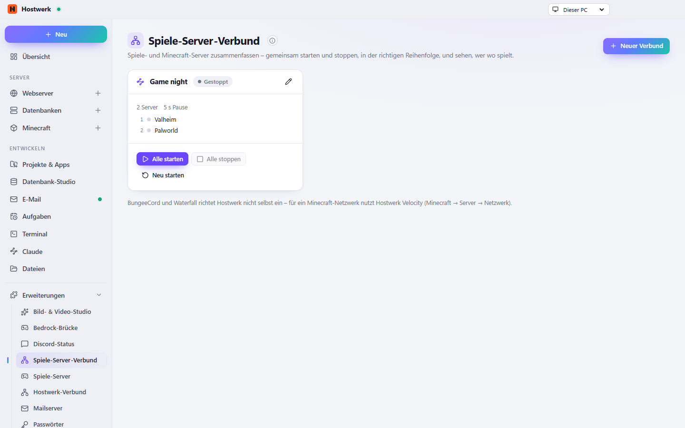

# Spiele-Server-Verbund

> **Aufgegangen in „Spiele-Server“ (2.0):** Der Verbund ist jetzt der Reiter „Verbund“ auf der Seite der Spiele-Server. Hostwerk installiert die neue Fassung von selbst und entfernt diese Erweiterung; die Verbünde bleiben. Hier gibt es keine neuen Fassungen mehr.

Spiele-Server, die zusammengehören, als Verbund: der Reihe nach starten, ein Zeitplan, dieselben Einstellungen, Ports und Spieler auf einen Blick.

[English](README.md) · Offizielle [Hostwerk](https://github.com/Passimoritz/hostwerk-public)-Erweiterung (native Erweiterung, ab Hostwerk 2.9)



## Was sie kann

- **Wo:** Spiele-Server → Verbund, Verbund-Karte jedes Minecraft-Servers und Übersichtskachel – seit 1.3.0 ohne eigenen Seitenleisten-Eintrag; die ganze Seite bleibt unter Erweiterungen → Öffnen
- **Verbünde aus Spiele-Servern**, die zusammengehören – ein Cluster (ARK, Conan Exiles), mehrere Instanzen eines Spiels, alles für den Spieleabend. Einzelne Minecraft-Server können dazugehören.
- **Der Reihe nach starten** (du legst sie fest; ein Proxy immer zuletzt) – Hostwerk wartet, bis jeder Server **wirklich bereit** ist (Spiele-Server: Antwort auf die Server-Abfrage, Minecraft: „Done“), auf Wunsch mit Pause obendrauf. Stoppen umgekehrt. Fällt ein Server aus, bleibt ein Proxy aus – mit der Frage „Trotzdem starten“.
- **Zeitplan:** jeden Tag neu starten mit Ansage im Chat, jeden Tag **sichern** (Spiele-Server: ihr Backup-Befehl, Minecraft: Hostwerks Sicherung) – oder „Alle sichern“ von Hand
- **Gemeinsame Einstellungen:** dasselbe Server-Passwort und dieselben Spielerplätze für jeden Spiele-Server (Steam-Server in Hostwerks Einstellungen, LinuxGSM-Server in ihrer Konfiguration)
- **Ports auf einen Blick** mit Konflikten gegen alle anderen Spiele- und Minecraft-Server auf diesem PC – und **Router-Freigaben für den ganzen Verbund** auf einmal (braucht „Router & Portfreigaben“ 1.2+, nur eigene Einträge)
- **Spieler** je Server (A2S) und gesamt, **Kachel** in der Übersicht mit allen Spielern aller Verbünde
- Die Seite jedes Minecraft-Servers zeigt, zu welchem Verbund er gehört; Rechtsklick-Menüs; andere Erweiterungen dürfen Reiter ergänzen

Minecraft-Netzwerke mit Proxy (Velocity/BungeeCord), Bedrock-Spielern und Versions-Brücken richtest du in der Erweiterung **[Minecraft-Servernetzwerk](https://github.com/Passimoritz/hostwerk-ext-mc-network)** ein – hier startest du sie zusammen mit anderen Spiele-Servern.

## Installieren

In Hostwerk unter **Erweiterungen → Entdecken** auf „Installieren“ klicken. Braucht `game-servers` – Hostwerk installiert das mit. Wer die Funktion schon in Hostwerk 2.8 benutzt hat, bekommt die Erweiterung beim Update automatisch – mit allen Daten.

Native Erweiterungen laufen als Teil von Hostwerk (eigener Server- und Oberflächen-Teil). Darum installiert Hostwerk sie nur aus dem offiziellen Katalog (mit Prüfsumme) oder im Entwickler-Modus.

## Daten

`settings.gameNetwork` – genau dort, wo Hostwerk sie schon immer abgelegt hat. Entfernen der Erweiterung löscht nichts.

## Entwickeln

```bash
node --test tests/*.test.js          # Tests
node build-native.js .               # Oberfläche bauen (sdk/build-native.js aus hostwerk-public)
node check.js . --strict             # Prüfung wie im Katalog (sdk/check.js)
```

Quelltext der Oberfläche in `ui/src`, Server-Teil in `server/`. Texte im Code sind Englisch, Deutsch steht in `locales/de.json`.

## Lizenz

MIT
