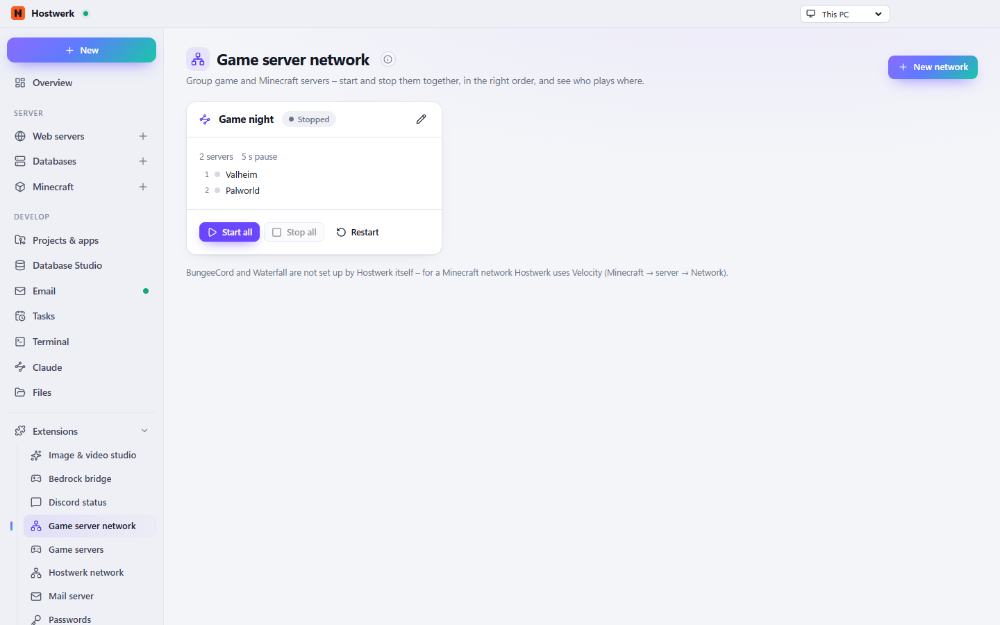

# Game server network

Game servers that belong together as one network: start them in order, one schedule, the same settings, ports and players at a glance.

[Deutsch](README.de.md) · An official [Hostwerk](https://github.com/Passimoritz/hostwerk-public) extension (SDK 2.7, native extension)



## What it does

- **Where:** Game servers → Network, the network card of every Minecraft server and the dashboard tile – no own sidebar entry since 1.3.0; the full page stays under Extensions → Open
- **Networks of game servers** that belong together – a cluster (ARK, Conan Exiles), several instances of one game, everything for game night. Single Minecraft servers can be part of it too.
- **Start in order** (you choose it; a proxy always last) – Hostwerk waits until each server is **really ready** (game servers: answer to the server query, Minecraft: “Done”), an extra pause on top if you like. Stop the other way round. If a server fails, a proxy stays off – with the question “Start anyway”.
- **Schedule:** restart every day with an announcement in the chat, **backup** of every server every day (game servers: their backup command, Minecraft: Hostwerk’s backup) – or “Back up all” by hand
- **Shared settings:** the same server password and player slots for every game server (Steam servers in Hostwerk’s settings, LinuxGSM servers in their config)
- **Ports at a glance** with conflicts against every other game or Minecraft server on this PC – and **router forwarding for the whole network** in one go (needs “Router & port forwarding” 1.2+, its own entries only)
- **Players** per server (A2S) and in total, **dashboard tile** with all players in all networks
- The page of every Minecraft server shows which network it belongs to; right-click menus; other extensions may add tabs

Minecraft networks with a proxy (Velocity/BungeeCord), Bedrock players and version bridges are set up in the extension **[Minecraft server network](https://github.com/Passimoritz/hostwerk-ext-mc-network)** – here they are started together with other game servers.

## Install

In Hostwerk: **Extensions → Discover** and click “Install”. Needs `game-servers` – Hostwerk installs it too. If you already used this feature in Hostwerk 2.8, the update installs the extension by itself – with all your data.

Native extensions run as part of Hostwerk (own server and interface part). That is why Hostwerk only installs them from the official catalogue (with checksum) or in developer mode.

## Data

`settings.gameNetwork` – exactly where Hostwerk always kept it. Removing the extension deletes nothing.

## Develop

```bash
node --test tests/*.test.js          # tests
node build-native.js .               # build the interface (sdk/build-native.js from hostwerk-public)
node check.js . --strict             # same check as the catalogue (sdk/check.js)
```

Interface source in `ui/src`, server part in `server/`. Texts in the code are English, German is in `locales/de.json`.

## License

MIT
